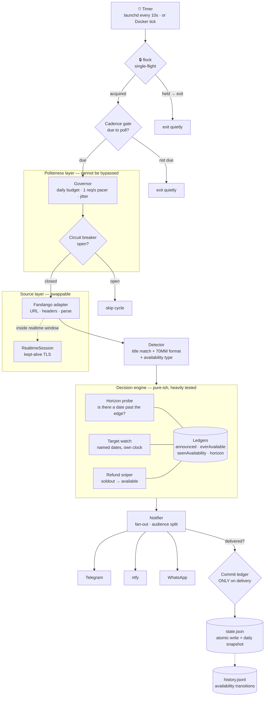
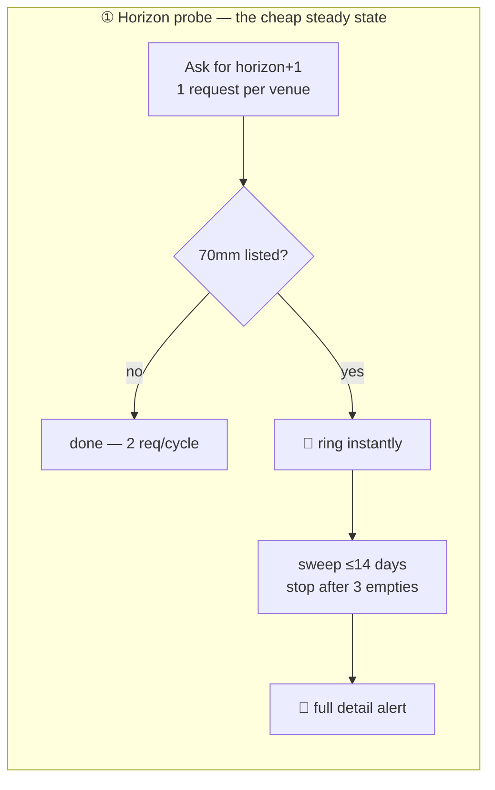
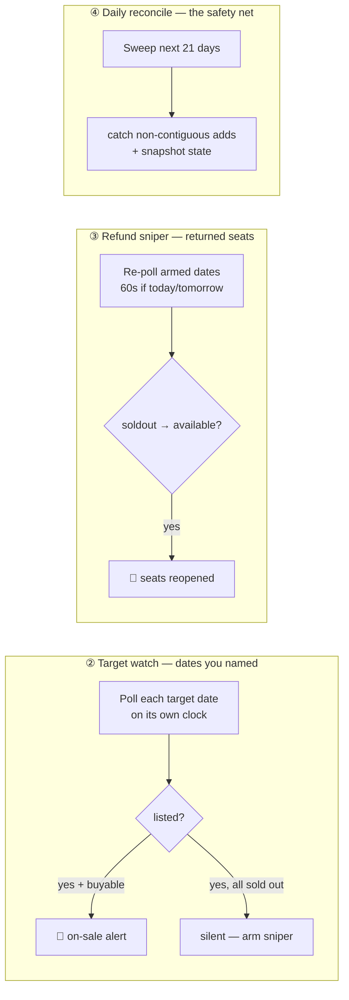
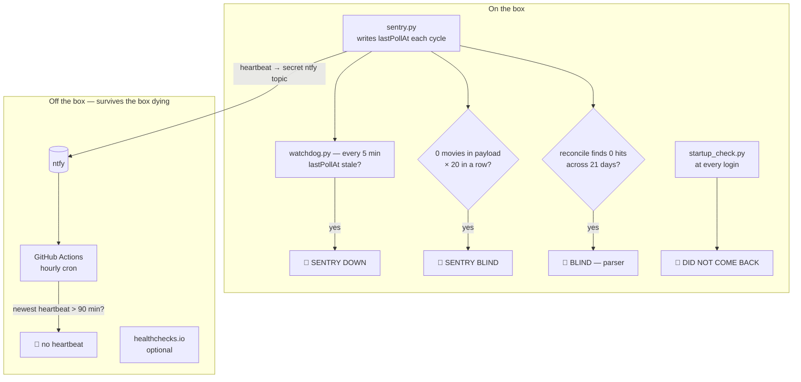
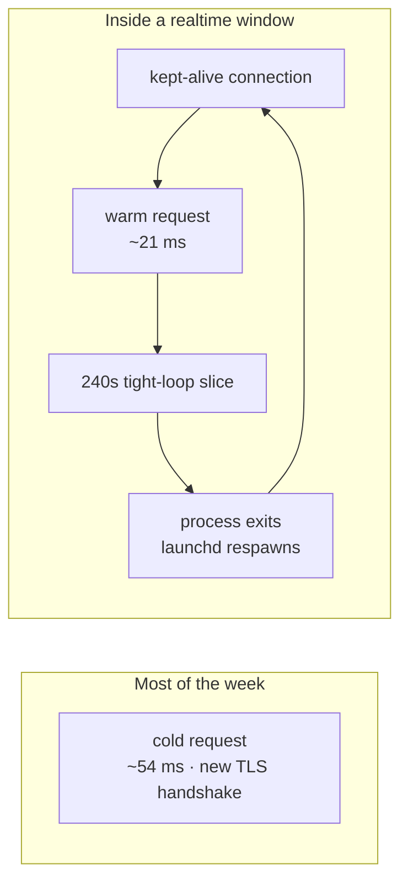
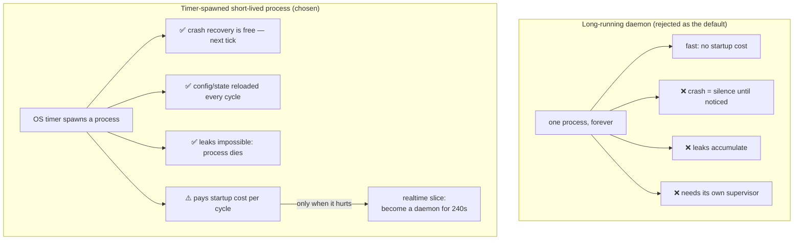
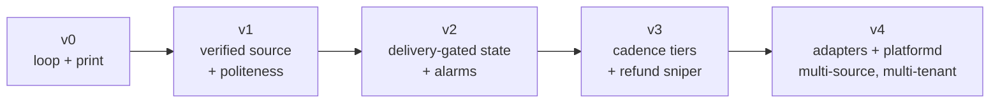

# Architecture

Diagrams of how the pieces fit. The discoveries that drove these choices are in
the [README](../README.md); the decision-by-decision rationale, including
options I rejected, is in [architecture-notes.md](architecture-notes.md).

Three things about the problem set everything else:

- **Latency is the metric.** Showtimes sell out in minutes, so seconds matter.
- **It runs unattended.** It has to survive reboots, sleep, crashes and network
  blips — and be able to tell me it's still alive.
- **A missed alert is a total loss.** No partial credit, so each way it can fail
  silently needs its own alarm.

And the constraint I hit on day one: there's no API. AMC 403s scripted
requests, and Fandango's `napi` endpoint only answers with a venue `Referer`
header (its `robots.txt` disallows `/napi/`). So this isn't "consume a feed,"
it's "poll something that never agreed to be polled, politely enough to keep
being served."

---

## 1. System at a glance

**The one rule that shapes the whole engine:** state advances only after a push
is confirmed delivered. Record-then-send loses an alert forever when a channel
blips; send-then-record retries. Every ledger write in the diagram sits
*downstream* of the delivery check, and that ordering is pinned by test.

---

## 2. Detection: four strategies, one budget

A single "check for new stuff" loop cannot cover the ways a ticket becomes
available. Four narrow detectors share one request budget instead.

Why four and not one:

- The **probe** is O(1) — it makes "nothing happened" nearly free, which is what
  buys the budget for everything else. It answers one bit: *is there anything
  past the edge of the known schedule?*
- The probe's blind spot is real and documented: it assumes AMC extends the run
  **contiguously**. On 2026-07-29 Aug 25 and Aug 26 went on sale while Aug 20–24
  stayed empty. The probe saw nothing.
- The **target watch** covers that by brute force for dates you actually care
  about, and the **reconcile** bounds the miss for everything else at ~24h.
- The **sniper** exists because listing ≠ buyable. AMC posts showtimes that are
  already sold out, so "a date appeared" and "you can buy a seat" are different
  events needing different alerts.

---

## 3. Observability: four alarms, because a quiet log looks healthy

The failure that matters most is not a crash — it is a watcher that keeps
running while silently seeing nothing. Four distinct silent failures, four
separate alarms, each proving something the others cannot:

The insight that forced the off-box layer: **every on-box alarm dies with the
box.** A watchdog cannot report that the machine is asleep, because it is asleep
too. The GitHub Actions cron is the only component that runs somewhere else, so
it is the only one that can report total loss — and it needs no third-party
account, just repo secrets.

The distinction between the alarms is deliberate:

| Alarm | Proves | Blind to |
|---|---|---|
| SENTRY DOWN | the process runs | it running while seeing nothing |
| SENTRY BLIND | payloads have content | content we parse wrongly |
| BLIND — parser | our matching still works | the box being gone |
| Actions deadman | the box exists at all | everything finer-grained |

---

## 4. Why polling, and how to make it faster

This was tested, not assumed. Fandango exposes **no websocket, no SSE**, and it
**ignores `If-None-Match`** (verified 2026-07-27: an ETag comes back, but a
conditional GET still answers `200` with the full body). Polling is not the
lazy choice; it is the only transport on offer.

Given that, latency is reduced along the only two axes available:

1. **Ask more often when it matters** — cadence tiers (realtime > burst >
   base > overnight), all evaluated in the *theater's* timezone, because AMC
   posts on Eastern afternoons and the laptop is on Pacific.
2. **Make each ask cheaper** — one kept-alive TLS connection across a burst,
   ~2.5× faster per poll.

The 240-second slice length is empirical, not arbitrary: process startup costs
~12s of seam (launchd respawn + config/state reload). At 55s slices that seam
ate ~18% of the window; at 240s it costs ~5%, while still bounding how long one
process can hold the lock or hang unnoticed.

---

## 5. Why a timer + lock instead of a daemon

The OS is a better supervisor than anything worth writing. launchd's `RunAtLoad`
plus a `StartInterval` gives restart-on-crash, restart-on-login, and
restart-on-boot for free — and `flock` makes overlapping ticks harmless, so the
timer can fire far more often than a cycle takes. The daemon shape is adopted
*temporarily*, only inside realtime windows, where the startup seam actually
costs detection latency.

---

## 6. How it grew

The architecture was not designed up front; each layer exists because something
specific broke. That history is the most useful part of this repo:

| Layer | The specific thing that broke |
|---|---|
| Verified source | AMC `403`s everything scripted; Fandango needs a `Referer` header |
| Politeness layer | Unthrottled polling is how you stop being served at all |
| Delivery-gated state | A failed push silently ate an alert, permanently |
| Watchdog + startup check | An Xcode install broke `/usr/bin/python3`; the watcher died quietly |
| Off-box deadman | The laptop slept, and nothing on it could say so |
| Cadence tiers | One interval cannot serve both a drop hour and 3am |
| Refund sniper | Listings arrive already sold out — "listed" ≠ "buyable" |
| `announced` ledger | Three code paths each alerted on the same date |
| Adapters + platformd | The same shape works for campsites, restocks, anything |

The generalization is real, not aspirational: `adapters/` already contains a
second working source (`recreation_gov.py`, 30 tests), and `platformd/` is a
multi-tenant service — API, subscriber channels, delivery outbox, governor —
with a small web UI branded **Dropwatch**. Run it with
`python3 -m platformd.api --demo` and open `127.0.0.1:8787`. The plan of record
is [docs/platform/README.md](platform/README.md).

---

## 7. What it deliberately does not do

The boundary is as designed as the features:

- **No auto-purchase, no checkout automation, no CAPTCHA solving, no queue
  bypass.** The tool tells a human to go buy a ticket. Beyond that line sits
  ticket-bot territory — the BOTS Act, ticketing ToS, and a fraud-detection
  arms race this has no business joining.
- **No seat-map scraping.** Availability is read at showtime granularity from
  the public listing (`available` / `soldout` / `restricted`). Exact remaining
  seats live behind a checkout session, and pointing a poller at checkout is
  how you get flagged.
- **No aggregator dependency.** An earlier version read a community tracker.
  That is a single point of failure someone else operates — first-party sources
  only.
- **No credentials anywhere.** The watcher never logs in. It reads public
  listings, and every secret lives in `config.json` (gitignored) or the
  environment.
